

# PRAKTIKUM 8 PEMROGRAMAN WEB

## MYSQL

**Nama** : Aidi Syahdan Firdaus  
**Nim** : 312510089  
**Kelas** : I251A

---

### Persiapan praktikum :

Nyalakan mysql dan apache di xampp

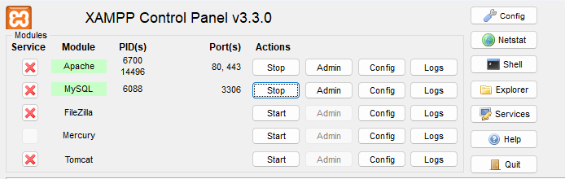

Lalu buat folder di directory xampp/htdocs

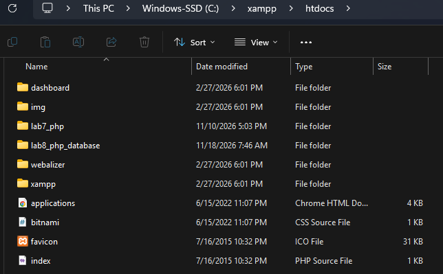

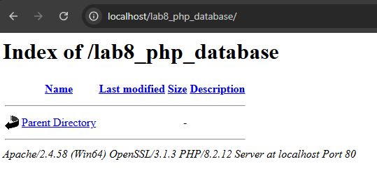

---

### Praktikum :

Buka cmd lalu masuk ke direktori xampp/bin, dan masuk ke root baru buat database

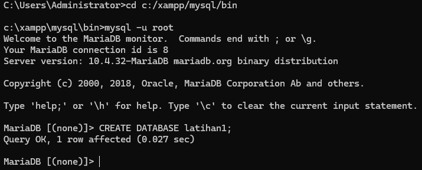

Lalu buat table di dalam database yang sudah di buat tadi ( masukkan query nya di localhost php my admin)

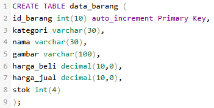

Tambahkan data di dalam table tadi

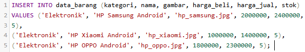

Hasilnya

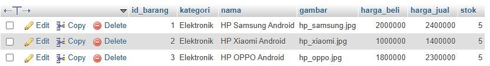

Buat file koneksi.php di dalam folder lab8_php_database

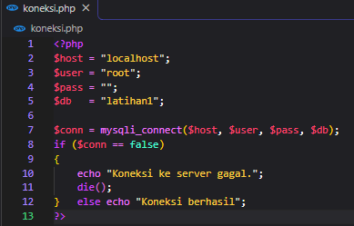

Hasilnya

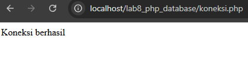

Buat file baru dengan nama index.php di dalam folder tadi

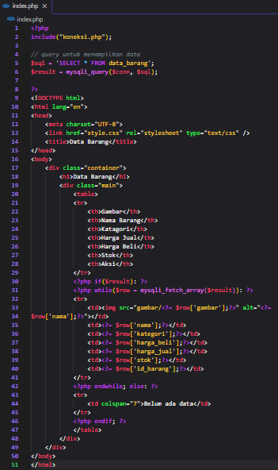

Hasilnya

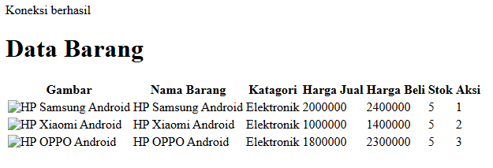

Buat file baru dengan nama tambah.php

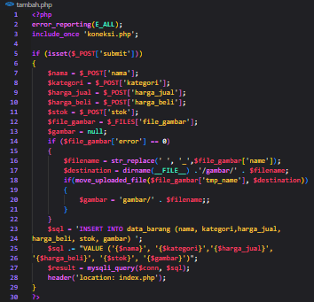

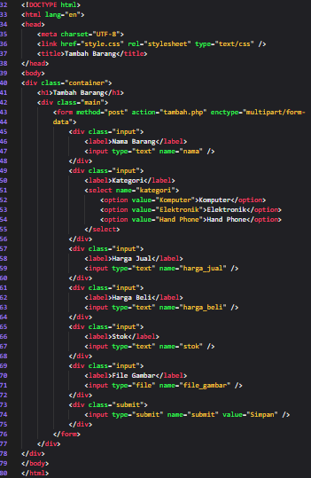

Sedikit penyesuaian di index.php

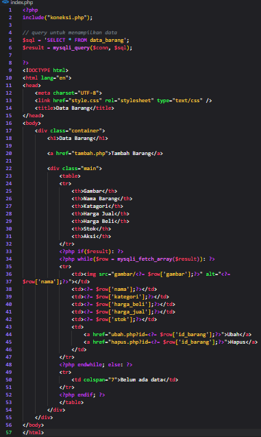

Hasilnya

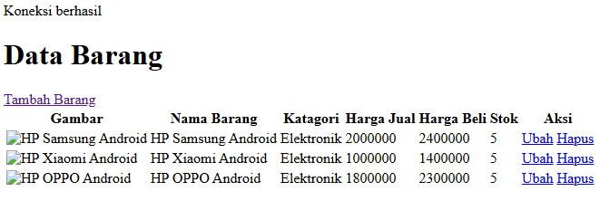

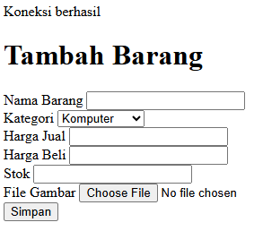

Buat file baru dengan nama ubah.php

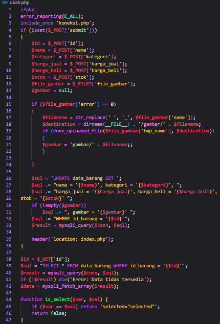

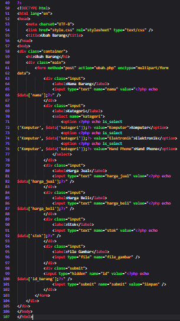

Hasilnya

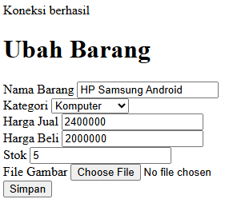

Menambahkan file style.css agar tampilan mirip seperti contoh di modul praktikum

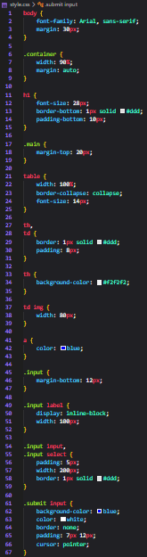

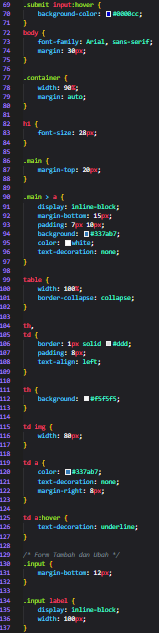

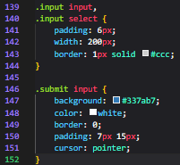

Hasilnya

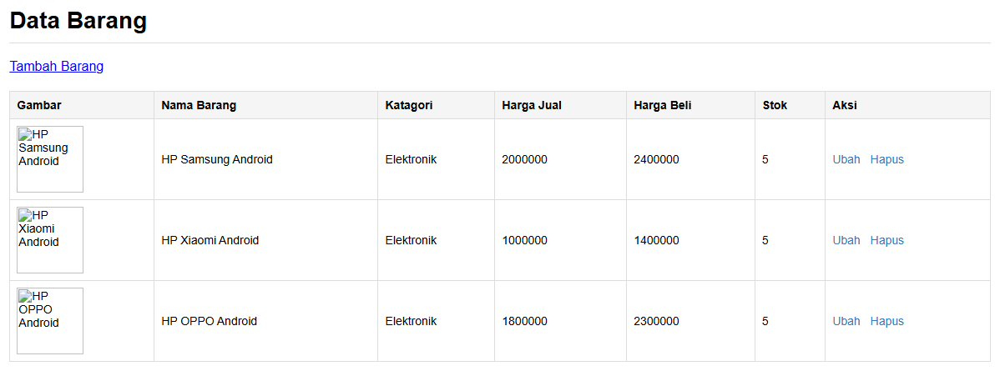

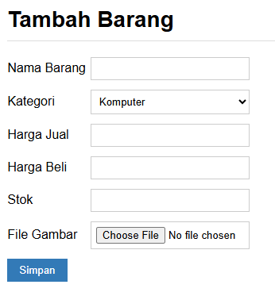

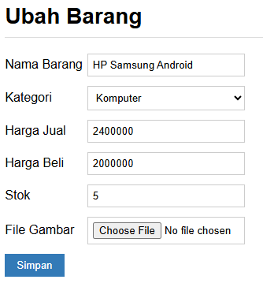

Buat file baru hapus.php

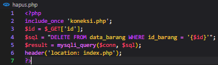

Saat di klik hapus (yang di hapus hp Samsung)

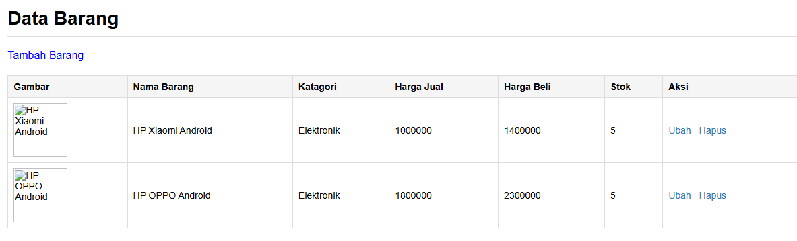

---

*Total 27 screenshot, urut sesuai laporan praktikum.*
